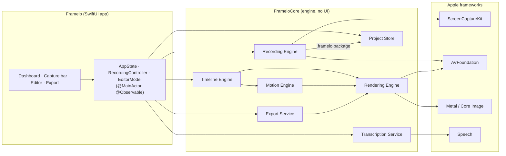
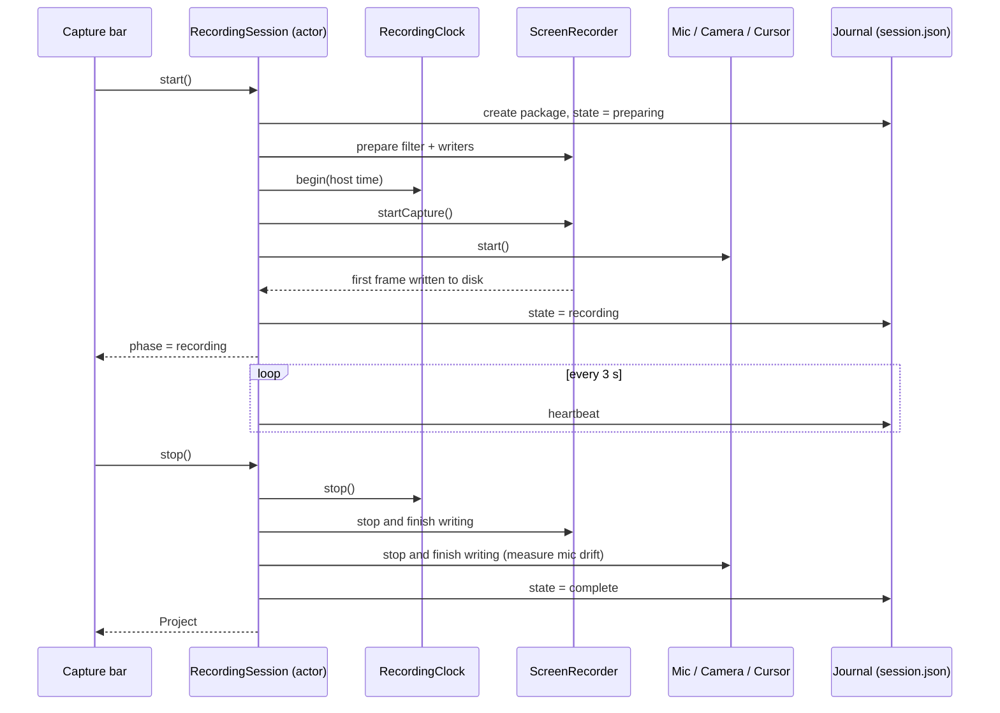
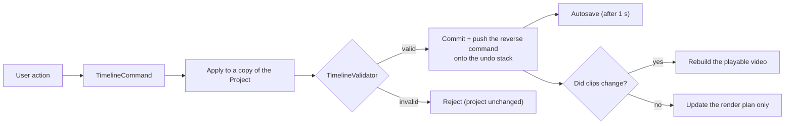
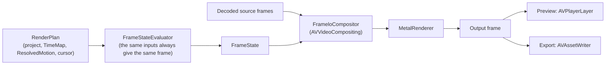

<p align="center">
  
</p>

<h1 align="center">Framelo</h1>

<p align="center">
  <b>A native macOS screen recorder and motion editor.</b><br>
  Record your screen, and Framelo turns it into a polished product video with automatic zooms,<br>
  a smooth cursor, styled backgrounds and a webcam overlay. Everything stays on your Mac.
</p>

<p align="center">
  
  
  
  
  
</p>

> **Windows:** a native Windows 10/11 version (C#/.NET 8, WinUI 3, Windows.Graphics.Capture, Media Foundation)
> lives in [`windows/`](windows/README.md). It shares this app's architecture and `.framelo` project format.

---

## Contents

1. [Overview](#overview)
2. [Features](#features)
3. [Quick start](#quick-start)
4. [System architecture](#system-architecture)
   - [Design principles](#design-principles)
   - [High-level architecture](#high-level-architecture)
   - [Components](#components)
   - [Recording pipeline](#recording-pipeline)
   - [Editing model](#editing-model)
   - [Motion engine](#motion-engine)
   - [Rendering pipeline](#rendering-pipeline)
   - [Export pipeline](#export-pipeline)
   - [Concurrency model](#concurrency-model)
   - [Storage format](#storage-format)
   - [Reliability and recovery](#reliability-and-recovery)
5. [Project structure](#project-structure)
6. [Building](#building)
7. [Testing](#testing)
8. [Keyboard shortcuts](#keyboard-shortcuts)
9. [Privacy](#privacy)
10. [Limitations](#limitations)
11. [Further reading](#further-reading)

---

## Overview

Framelo is built only with Apple frameworks: **SwiftUI**, **ScreenCaptureKit**, **AVFoundation**, **Metal**, **Core Image** and **Speech**. It has no third-party dependencies.

Editing is **non-destructive**: your original recordings are never modified. Every edit (cut, zoom, style, caption) is saved as a set of instructions in a small JSON file, and those instructions are only applied when the video is rendered.

| | |
|---|---|
| **Platform** | macOS 14 Sonoma or later |
| **Language** | Swift 6, strict concurrency checking |
| **Architecture** | MVVM on top of a UI-free engine module (`FrameloCore`) |
| **Rendering** | Metal, through a custom `AVVideoCompositing` compositor |
| **Persistence** | Codable JSON in self-contained `.framelo` project packages |
| **Tests** | 62 Swift Testing tests that generate their own sample media |

## Features

| Capture | Edit | Output |
|---|---|---|
| A whole display, one window, or a selected area | Cut, trim, split, reorder, change speed, close gaps | MP4 or MOV |
| Microphone, with optional noise reduction | Automatic zooms suggested from your clicks, all editable | H.264 or HEVC |
| System audio | Manual zooms and camera keyframes with five easing curves | 720p, 1080p or 4K |
| Webcam on its own track | Cursor smoothing, click effects, motion blur | 30 or 60 fps |
| 30 or 60 fps, at native or reduced resolution | Wallpapers, gradients, padding, corners, shadow, inset, crop | Progress, cancel, size estimate |
| Floating capture bar, countdown, pause/resume | Webcam picture-in-picture, text, captions, transitions | Output checked before it is saved |
| Global shortcuts and a menu-bar timer | Unlimited undo/redo and autosave | Notification when done |

## Quick start

```bash
git clone https://github.com/Gokulakrishnxn/Framelo.git
cd Framelo
Scripts/build-app.sh
open build/Framelo.app
```

The first time you record, allow **Screen & System Audio Recording** (and **Microphone** / **Camera** if you use them) under *System Settings › Privacy & Security*, then reopen Framelo.

---

## System architecture

### Design principles

| Principle | How it is applied |
|---|---|
| **Never lose a recording** | Files are written in fragments every 2 s, a journal tracks each session, and interrupted recordings are recovered at the next launch. |
| **Never touch the originals** | Edits are instructions in a project file; source media is only ever read. |
| **What you see is what you export** | The preview and the export use the same renderer, fed the same frame description. A test checks the pixels match. |
| **Exact timing** | All times are whole-number ticks (60 000 per second), so cuts and speed changes never drift. |
| **Every edit is undoable and checked** | Each change is a command applied to a copy of the project and validated before it is kept. |
| **No hidden blocking** | Each recording track, the project store and every export run on their own threads. The UI stays on the main thread. |

### High-level architecture



The codebase is split into two modules:

- **`FrameloCore`**: the engine. It has no UI code, is fully covered by tests, and can be reused in other apps.
- **`Framelo`**: the SwiftUI app. Its view models (marked `@Observable`) turn user actions into engine calls.

### Components

| Component | Responsibility | Key types |
|---|---|---|
| **Recording Engine** | Records screen, system audio, microphone, webcam and cursor on one shared clock | `RecordingSession`, `ScreenRecorder`, `MicRecorder`, `CameraRecorder`, `CursorRecorder`, `RecordingClock`, `TrackWriter` |
| **Recovery** | Rebuilds projects from interrupted recordings; sets aside files it can't use | `RecordingJournal`, `RecoveryService`, `RecordingFinalizer` |
| **Timeline Engine** | Edit operations, validation, undo/redo, and mapping timeline time to source time | `TimelineEditor`, `TimelineValidator`, `CommandStack`, `TimeMap` |
| **Motion Engine** | Suggests zooms from clicks, resolves conflicts, builds a continuous camera path, smooths the cursor | `MotionEngine`, `AutoZoomGenerator`, `CameraPath`, `CursorSmoother` |
| **Rendering Engine** | Describes each frame as data, then draws it with Metal | `FrameStateEvaluator`, `FrameLayout`, `MetalRenderer`, `FrameloCompositor` |
| **Media Engine** | Assembles the edit into a playable video, inspects media, makes thumbnails and waveforms | `CompositionBuilder`, `MediaInspector`, `ThumbnailGenerator`, `WaveformGenerator` |
| **Services** | Saving and loading, export, transcription, permissions | `ProjectStore`, `ExportService`, `TranscriptionService`, `PermissionManager` |

### Recording pipeline



- **One clock for every track.** Every buffer's system timestamp is converted to *session time* by `RecordingClock`, which also removes paused periods. Each file records the time of its first sample, so all tracks line up exactly in the editor.
- **"Recording" means recording.** The UI only switches to recording once the first video frame is actually on disk.
- **Microphone drift correction.** Microphone audio is placed by sample count. Its drift against the clock is measured, and a correction is applied only if the drift is within normal hardware tolerance.
- **The cursor is recorded separately**, 120 times a second, without needing Accessibility permission. It is drawn back in at render time, which is what makes smoothing, resizing and click effects possible.
- **Framelo's own windows are excluded** from capture, so the capture bar, countdown and recording controls never appear in your video.

### Editing model



- A **`Project`** is a plain value: sources, tracks, clips, zooms, keyframes, text, captions and settings.
- **`TimeMap`** converts timeline time to source time exactly, including gaps, speed changes and splits. A split never loses or duplicates a frame.
- **Undo is command-based.** Continuous changes such as dragging a slider are merged into a single undo step.
- **Clip changes rebuild the playable video. Style changes only update the renderer's frame description**, so they appear on screen instantly.

### Motion engine

How zoom events become a camera move:

1. **Suggest**: group clicks that are close in time into zoom events.
2. **Protect manual edits**: never place a suggestion over a manual zoom, keyframes, or a spot where you deleted a suggestion.
3. **Merge**: combine zooms that are too close together, so the camera doesn't zoom out and straight back in.
4. **Clamp**: keep the zoomed view inside the picture, and lengthen transitions for bigger zooms.
5. **Follow**: within a zoom, the camera follows the cursor with a damped spring that starts at rest, so there are no sudden jumps.

`CameraPath` can give the camera position at any moment, and gives the same answer every time. Tests sample it 240 times a second for every easing curve and check that the view never jumps or leaves the picture.

### Rendering pipeline



`FrameState` is a plain description of one frame: which source frame to show, the camera position and speed, the cursor position, size and shape, click effects, the webcam overlay, text and captions. It is the **only** thing the renderer draws from, which is why preview and export always match.

The `MetalRenderer` draws everything in one GPU pass:
- the background (colour, gradient, or image with optional blur)
- the screen card with rounded corners, shadow, inset border, crop and window frame
- motion blur, cursor and click effects
- the webcam overlay, then text and captions on top

It reuses its GPU resources from frame to frame: drawing pipelines are prepared once per pixel format, decoded video frames are used without copying, and fixed images (cursor shapes, backgrounds, text) are cached. The shaders are compiled when the app starts, so building does not require the full Xcode Metal toolchain.

### Export pipeline

1. **Check first:** that the project is valid, the source files are present, the format and size are supported, and there is enough disk space.
2. **Render:** the composed video is read frame by frame through the Metal compositor and written to a new file in a private work folder. Progress is reported and the export can be cancelled.
3. **Verify:** the output file is reopened and its duration, size, codec, frame rate and audio track are checked.
4. **Save:** the file is only moved to your chosen location if it passes. Cancelling or a failure deletes the work folder, and errors tell you how to fix the problem.

### Concurrency model

Framelo compiles with **Swift 6 strict concurrency checking**. The table shows where each part runs and what it owns.

| Part | Runs on | Owns |
|---|---|---|
| Views, `AppState`, `EditorModel`, `RecordingController` | Main thread (`@MainActor`) | UI state, the preview player |
| `RecordingSession`, `ProjectStore` | Their own `actor` | Session state and journal; reading and writing project files |
| Screen / Mic / Camera / Cursor recorders | One dedicated queue each (also used for system callbacks) | That track's file writer |
| `FrameloCompositor` | Video-decoding threads, one at a time per compositor | One renderer and a small cache of recent frames |
| `MetalRenderer` | Whoever owns it | Its GPU command queue and cached images |
| `Project`, `TimeMap`, `CameraPath`, `FrameState`, `RenderPlan` | Anywhere | Immutable values (`Sendable`) |

Recording and export can be stopped at any point and always clean up. Every place that relaxes the compiler's concurrency checks is listed with its reason in [DECISIONS.md](DECISIONS.md).

### Storage format

```
~/Movies/Framelo/Projects/<uuid>.framelo/
├── project.json        # edit instructions (Codable, versioned)
├── session.json        # recording journal: state, track start times, heartbeat
├── cursor.jsonl        # cursor samples, clicks and cursor shapes, one per line
├── poster.jpg          # library thumbnail
└── media/
    ├── screen.mov          # H.264, written in fragments (readable even after a crash)
    ├── system-audio.mov    # AAC
    ├── microphone.mov      # AAC
    └── camera.mov          # H.264
```

`project.json` is saved atomically: written in full to a temporary file, then swapped in. Imported videos are referenced where they are and never copied or changed. Projects saved by older versions still open, because newer settings are optional.

### Reliability and recovery

| Failure | What happens |
|---|---|
| App crash or power loss while recording | The video up to the last flushed fragment (at most 2 s lost) is recovered at the next launch and marked **Recovered** |
| Display unplugged, window closed, permission revoked | Recording stops cleanly and everything captured so far is saved |
| Microphone or camera unavailable | Recording continues without that track and you get a notice |
| Session files that can't be recovered | Moved to `Recovery/Quarantine`, never deleted |
| An invalid edit | Rejected; the project is left unchanged |
| Export cancelled or failed | Leftover files are removed and you get an error that says how to fix it |

---

## Project structure

```
Framelo/
├── Package.swift                 # FrameloCore (library), Framelo (app), FrameloTests
├── Sources/
│   ├── FrameloCore/              # engine, no UI
│   │   ├── Models/               # Project, clips, zooms, keyframes, styles, MediaTime
│   │   ├── Timeline/             # TimeMap, TimelineEditor, TimelineValidator, commands
│   │   ├── RecordingEngine/      # session, recorders, clock, journal, recovery
│   │   ├── MotionEngine/         # auto zoom, CameraPath, cursor smoothing
│   │   ├── RenderingEngine/      # FrameState, layout, shaders, renderer, compositor
│   │   ├── MediaEngine/          # composition, inspection, thumbnails, import, waveforms
│   │   ├── Services/             # ProjectStore, ExportService, TranscriptionService
│   │   └── PermissionManager/
│   └── Framelo/                  # SwiftUI app
│       ├── App/                  # app entry point, AppState, menu bar, global shortcuts
│       ├── DesignSystem/         # colours, typography, buttons, inputs
│       └── Features/             # Dashboard, Recording, Editor, Timeline, Motion, Export
├── Tests/FrameloTests/           # Swift Testing suites + sample media generator
├── Resources/                    # Info.plist, entitlements
└── Scripts/                      # build, test, bundle, verify and icon scripts
```

## Building

| Command | Result |
|---|---|
| `Scripts/build-app.sh` | Release build, signed, at `build/Framelo.app` |
| `Scripts/build-app.sh debug` | Debug build |
| `Scripts/build.sh` | Compile only (`swift build`) |
| `Scripts/test.sh` | Run the tests |
| `Scripts/verify-bundle.sh` | Check the app's Info.plist, privacy descriptions, icon and signature |

You can build with full **Xcode** or with just the **Command Line Tools**. `Scripts/toolchain.sh` picks a compatible macOS SDK and testing setup automatically when Xcode isn't installed. The app is signed so that macOS keeps its privacy permissions across rebuilds.

## Testing

The tests generate their own sample media. Each test video frame encodes its own frame number, so a test can check exactly which source frame ended up at each moment of the output.

| Area | What is checked |
|---|---|
| Time and timeline | Exact time maths; splits lose no frames; speed changes; gaps; a one-hour timeline with mixed speeds |
| Undo/redo | Undo restores the exact original; invalid edits leave the project unchanged; slider drags merge into one step |
| Recording | Pause handling, drift detection, cursor log parsing, file start times |
| Crash recovery | A recording interrupted mid-write is recovered without changing its media; unusable files are set aside |
| Motion | Clustering, merging, manual zooms winning, the view never leaving the picture, no jumps for any easing |
| Rendering | Pixel checks for layout, zoom, crop and inset; **preview and export pixels match** |
| Export | Frame-accurate edits, HEVC, audio, variable frame rate, long edits, cancellation, clear error messages |

```bash
Scripts/test.sh                                   # everything
Scripts/test.sh --filter ExportTests              # one suite
FRAMELO_REAL_PROJECT=~/Movies/Framelo/Projects/<id>.framelo \
  Scripts/test.sh --filter RealProjectTests       # export one of your own recordings
```

See [TESTING.md](TESTING.md) for the manual test checklist.

## Keyboard shortcuts

| Action | Shortcut |
|---|---|
| New recording | ⌘N |
| Stop / start recording (anywhere) | ⇧⌘2 |
| Pause / resume recording (anywhere) | ⇧⌘P |
| Play / pause | Space |
| Previous / next frame | ← / → |
| Split at playhead | ⌘B |
| Delete selection | ⌫ |
| Back to settings | Esc |
| Undo / redo | ⌘Z / ⇧⌘Z |
| Add zoom / keyframe / text | ⌥Z / ⌥K / ⌥T |
| Export | ⌘E |

## Privacy

- Recordings, projects and exports stay on your Mac, in `~/Movies/Framelo`.
- Framelo makes no network requests.
- Captions use Apple's speech recognition **on your Mac** whenever the system supports it.
- Each permission is requested only when the feature that needs it is used.

## Limitations

- No iPhone/iPad ("Device") capture source yet.
- The device frame is a drawn window title bar, not real device artwork.
- Noise reduction is Apple's voice processing, applied while recording, not afterwards.
- Transitions: fade and zoom-fade.

Current verification status is tracked in [DEVELOPMENT_STATUS.md](DEVELOPMENT_STATUS.md).

## Further reading

| Document | Contents |
|---|---|
| [ARCHITECTURE.md](ARCHITECTURE.md) | Module-level reference |
| [DECISIONS.md](DECISIONS.md) | Key technical decisions and the reasons for them |
| [TESTING.md](TESTING.md) | Running tests and the manual test checklist |
| [DEVELOPMENT_STATUS.md](DEVELOPMENT_STATUS.md) | What is verified, what still needs checking, known limits |
| [windows/README.md](windows/README.md) | The Windows version: features, building, testing, architecture |
| [windows/DECISIONS.md](windows/DECISIONS.md) | Windows-specific technical decisions |

---

<p align="center">Built by <b>Gokulakrishnan</b> · <a href="https://github.com/Gokulakrishnxn">@Gokulakrishnxn</a></p>
