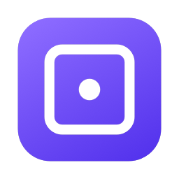

<p align="center">
  
</p>

<h1 align="center">Framelo</h1>
<p align="center"><b>Record your screen. Get a polished product video.</b><br>
A native macOS screen recorder and motion editor, built entirely with Apple frameworks.</p>

---

## What it does

Framelo records your screen, then turns that raw recording into a clean demo video. It adds smooth zooms that follow your clicks, a smoothed cursor, a styled background, your webcam in a corner, captions and titles. Then it exports a video that is checked before it is saved.

Everything runs on your Mac. Recordings, projects and transcription stay on your machine.

| Record | Edit | Export |
|---|---|---|
| Display, window or region | Cut, trim, split, reorder, change speed | MP4 or MOV |
| Microphone (with optional noise reduction) | Zooms suggested from your clicks, all editable | H.264 or HEVC |
| System audio | Camera keyframes with five easing curves | 720p, 1080p or 4K |
| Webcam | Cursor smoothing, click effects, motion blur | 30 or 60 fps |
| Countdown, pause/resume, floating controls | Backgrounds, padding, corners, shadow, window frame | Progress, cancel, size estimate |
| Global shortcuts, menu bar timer | Webcam picture-in-picture, text, captions, transitions | Output checked before saving |

## Requirements

- macOS 14 Sonoma or later, Apple silicon or Intel with Metal
- To build: Swift 6 toolchain (Xcode **or** just the Command Line Tools)

## Build and run

```bash
git clone https://github.com/Gokulakrishnxn/Framelo.git
cd Framelo
Scripts/build-app.sh          # builds build/Framelo.app (release, ad-hoc signed)
open build/Framelo.app
```

Run the tests:

```bash
Scripts/test.sh
```

> **Command Line Tools only?** That works. The scripts pick a compatible SDK and the testing plugin automatically. See [DECISIONS.md](DECISIONS.md).

### Permissions

On first use macOS asks for **Screen Recording**, **Microphone** and **Camera**. Turn them on in *System Settings › Privacy & Security*, then reopen Framelo. Because builds are ad-hoc signed, macOS may ask again after a rebuild.

## Using Framelo

1. **New Recording** (⌘N): pick a display, window or region, and choose your inputs.
2. Recording starts after the countdown. Use the floating panel, the menu bar, or **⇧⌘2** to stop and **⇧⌘P** to pause.
3. The editor opens with zooms already suggested from your clicks.
4. Edit on the timeline: **⌘B** split, **⌘⌫** delete, drag clip edges to trim, **⌥Z** zoom, **⌥K** keyframe, **⌥T** text, **Space** play.
5. **Export** (⌘E).

Projects live in `~/Movies/Framelo`. If a recording is interrupted (crash, power loss), Framelo recovers it at the next launch.

## Project layout

```
Sources/FrameloCore   Engine (no UI): models, timeline, recording, motion, rendering, export
Sources/Framelo       SwiftUI app: dashboard, recording flow, editor, timeline, export
Tests/FrameloTests    Swift Testing suites with synthetic media fixtures
Scripts/              build, test, bundle and icon scripts
```

## Documentation

- [ARCHITECTURE.md](ARCHITECTURE.md): how the pieces fit together
- [DECISIONS.md](DECISIONS.md): key technical decisions and why
- [TESTING.md](TESTING.md): what is tested and how
- [DEVELOPMENT_STATUS.md](DEVELOPMENT_STATUS.md): what's done, what's verified, what's left

## Author

Built by **Gokulakrishnan** ([@Gokulakrishnxn](https://github.com/Gokulakrishnxn)).
